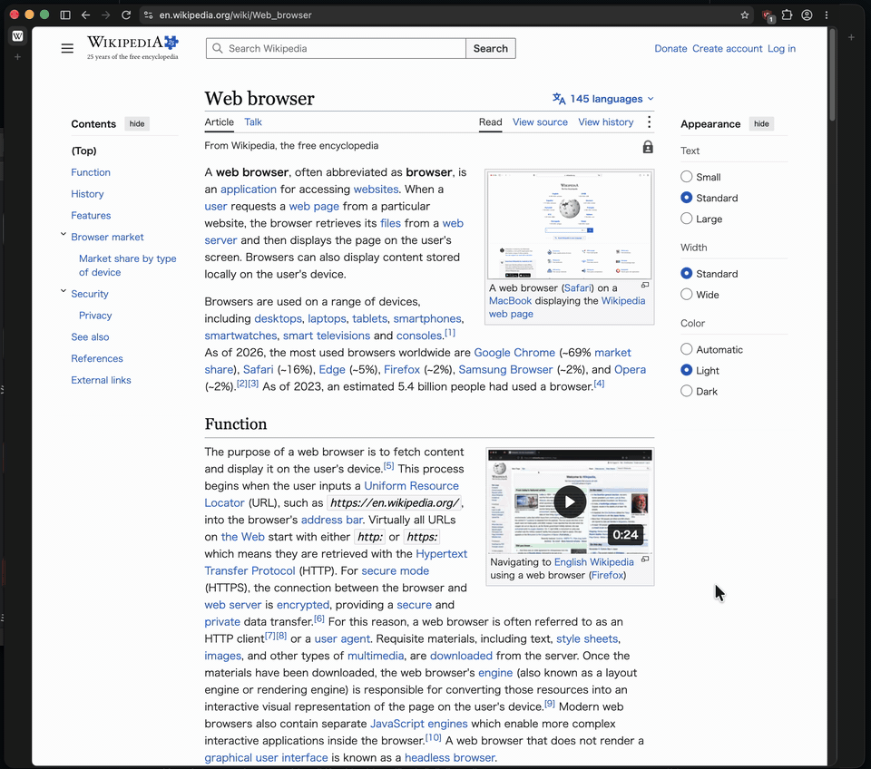

# Dual — Unofficial Helium derivative

Dual places two independent tab bars and browser panes in one window. Unlike a conventional Split View that places two tabs side by side, each side of Dual manages multiple tabs independently.

The same layout can be created by positioning two separate windows, but Dual integrates that workflow into one window. Dragging the divider resizes both panes together, so each window does not need to be positioned or resized separately.

## Download

[Download Dual-6.4.0-macOS-arm64.dmg](https://github.com/atemizu/Dual/releases/download/v6.4.0/Dual-6.4.0-macOS-arm64.dmg)

Open the DMG and copy Dual 6.4.0.app to Applications. This build is for Apple Silicon Macs. The distributed app is ad-hoc signed and is not signed or notarized with an Apple Developer ID.

### If macOS won't open the app

Because the app is not notarized, macOS blocks it the first time ("cannot be opened", "Apple could not verify…", or "is damaged").

1. Try to open Dual 6.4.0 once, then close the warning.
2. Open **System Settings → Privacy & Security**, scroll down, and click **Open Anyway** next to the message about Dual 6.4.0. Confirm with your password.

If the app is reported as damaged, or Open Anyway does not appear, remove the download quarantine flag in Terminal:

```sh
xattr -dr com.apple.quarantine "/Applications/Dual 6.4.0.app"
```

Dual 6.4.0 uses the same bundle identifier as Dual 5 and earlier Dual 6 releases, so an existing profile carries over. Quit the older Dual before opening Dual 6.4.0.

## What's new in 6.4.0

- **Page translation between Japanese and English, on your Mac** (the button with two speech bubbles). Translates the page you are looking at in place, with a language model that runs on the Mac itself: the page's text is never sent anywhere. The first time, the popup offers to download the model (5.0 GB, once). Links and formatting stay, what is on screen comes first and the rest follows as you scroll, and "Show original" puts the page back exactly as it was. See [Page translation](#page-translation).
- **Based on Helium 0.20.1.1 / Chromium 156** (was Helium 0.17.2.2 / Chromium 153 in 6.2.4), with the upstream fixes and security updates that come with it.

Dual 6.3.0 was prepared but not released; everything in it is part of 6.4.0:

- **No blank area while you drag the divider.** The two sides now change width at the same moment, once both pages have drawn at their new size. Before, a page that was slow to redraw left a blank band beside it for as long as the drag went on. If a page needs a moment, a thin bar shows where the divider is going and the sides follow as soon as they are ready.
- **The divider goes further.** A side can be as narrow as 280 points (was 360), and the split can range from 10% to 90% (was 15% to 85%).
- **Site Time Limit** (the green hourglass button). Limits how long you can keep looking at a site in one go: 15 minutes, 30 minutes or an hour in one click, or any number of minutes. When the time is up, the site's tab shows a break page until a rest has passed (five minutes unless you change it). It is about one sitting, not a daily total, and a limit stays on its site until you remove it. See [Bundled extensions](#bundled-extensions).
- **Closing unused tabs** (optional, off by default). In Settings → Performance you can have Dual close tabs you have not used for a number of hours that you enter, with a box to keep tabs that are playing sound. See [Closing unused tabs](#closing-unused-tabs).
- **Pinned tabs come back on their own side.** Tabs pinned in the right tab bar used to come back in the left one when Dual was opened again.
- **A hidden side's tabs open it.** With one side hidden, clicking one of its tabs shows that side with the tab. Clicking the side's current tab used to close it instead, because its close button came up under the pointer.
- **Hide either side at any time.** The side that is showing keeps its hide button (×) while the other side is hidden; pressing it shows the other side in its place.
- **Frameless mode: clicks on the other side's tab bar land where you aim.** With a side left on a new tab page, a click on its tab bar while you were using the other side could do nothing (the hide button) or pick the tab above the one you clicked, because that side's toolbar slid in and pushed the tab bar down under the pointer. The toolbar now waits until the mouse button is up. A side you have stopped using also no longer keeps its toolbar on screen until the pointer next passes over it.
- **Report a problem** (the orange bug button). Opens a form that drafts a bug report, with details of your setup, and hands it to this project's issue page on GitHub. Nothing is sent until you submit it there.
- Fixed a crash when an Incognito (private) window is closed, or when Dual quits with one open. Dual 6.2.4 crashes every time in these cases, and 6.2.3 was confirmed to crash when an Incognito window is closed, so please update. Earlier versions were not checked.
- Dual's own button labels are in English when the interface language is not Japanese (they were always Japanese).

Earlier changes (6.2.4): in Frameless mode (the setting under Appearance; "Zen mode" in the source) the right side appears the same way as the tab bar on the left — a rounded panel that slides in from the window edge — and so does a hidden left or right browser; the panel for reopening a closed left browser no longer hides behind the remaining browser; a browser's toolbar makes room for the window buttons before they move to it; the left tab bar's hide button (×) appears as soon as both browsers are open; the cursor is no longer re-registered on every mouse move (about two thirds less browser CPU time while the pointer moves over a page, in our measurement on macOS 27); Dual no longer sends crash reports.

Earlier changes (6.2.3): resize the window from any side; in Frameless mode the outer strip stays hidden until the pointer reaches that edge and the window buttons fade with the toolbar; the right hide button sits at the right end of its tab bar; drag the outer strip to move the window; the app shows Dual's own name and logo.

Earlier changes (6.2.2): based on Helium 0.17.2.2 / Chromium 153 with Helium's release configuration, smoother divider dragging, no separate title bar, rounded corners, optional Frameless mode, and a fix for panes staying dimmed after adding an extension.

Details: [MODIFICATIONS.md](MODIFICATIONS.md).

## Project status

The former development name was Helium Dual. Some legacy names remain in storage paths and internal identifiers (such as `helium://` pages) for compatibility. Inside the app, Dual uses its own name and logo; text about Helium's online services and the credits keep Helium's name. Dual is an unofficial project and is not affiliated with imput LLC or the Helium project.

- Based on Helium 0.20.1.1 / Chromium 156.0.8078.47
- Target platform: macOS arm64 (Apple Silicon)
- Modified files: [MODIFICATIONS.md](MODIFICATIONS.md), [modifications.json](modifications.json)
- Build instructions: [BUILDING.md](BUILDING.md); moving to a newer Helium: [UPDATING.md](UPDATING.md)
- Validation scope: [VALIDATION.md](VALIDATION.md)

## Helium services

Like Helium, Dual can use Helium's online services (for example, for extension downloads) when you enable them. Helium's privacy policy states that it does not apply to third-party or unofficial builds, so it does not cover Dual.

Dual does not send crash reports. Helium's crash reporting service is for Helium's own builds, and Dual's own changes can be the cause of a crash, so from 6.2.4 the crash reporting setting is fixed to Disabled and the app contains no upload address for crash reports. (Dual 6.2.3 and earlier asked after a crash by default and sent a report to Helium's service if you agreed, or automatically if you chose that; please set crash reporting to Disabled there.)

## Closing unused tabs

Settings → Performance → "Close tabs that have not been used for a long time". It is off until you switch it on.

- You enter the time in hours (1 to 8760; 24 to begin with). A tab is closed once it has gone unused for that long.
- "Do not close tabs that are playing sound" is ticked to begin with.
- Never closed: pinned tabs; the tab in front on each side; tabs that are on screen or taking part in a call, a recording, screen sharing or picture-in-picture; tabs whose page asks before you leave it; tabs in Incognito windows.
- Time is counted from the moment you switch it on, so nothing closes right away. Nothing closes in the ten minutes after Dual starts or the Mac wakes, either.
- Closed tabs go to History → Recently closed, like tabs you close yourself. Dual keeps only the latest 25 there; everything remains in the browsing history.

## Page translation

**Dual Page Translate** (Dual ページ翻訳) translates the page in the current tab between Japanese and English.

- Click its button and choose "Translate into Japanese" or "Translate into English"; the popup suggests the direction from the language of the page. You can also right-click the page and choose "Translate this page (Japanese ⇄ English)", or set a keyboard shortcut at `helium://extensions/shortcuts`. Doing it again on a translated page shows the original.
- The translation is done on your Mac by a language model, [Gemma 4 E4B](https://huggingface.co/unsloth/gemma-4-E4B-it-GGUF) (Google DeepMind; 4-bit version by Unsloth; Apache License 2.0), run by [llama.cpp](https://github.com/ggml-org/llama.cpp) on the Mac's GPU. The text of the page is never sent anywhere.
- The model is not part of the app. The first time, the popup shows its size (5.0 GB) and the free space on the disk, and downloads it when you click Download: once, from Hugging Face, a fixed version that is checked against its SHA-256 before it is used. A download that stops can be resumed. The model is kept in `~/Library/Application Support/Dual Translation`; delete that folder to remove it.
- What is on screen is translated first, a few paragraphs at a time, so that each is read with the ones around it; the rest follows as you scroll. Text that a page adds later (more results, comments) is translated as it appears.
- Links, bold and italic text and pictures stay where they belong in the translation. Code, and anything a page marks as not to be translated, is left as it is. Names often stay as they are. If a link cannot be placed in a translated paragraph, that paragraph is left untranslated rather than losing the link.
- "Show original" (in the popup, and in the note at the bottom right of the page) puts the page back exactly as it was.
- Speed depends on the Mac and the page. Several requests are translated at once on the GPU. On an M4 Max the first paragraphs appear within a few seconds, and the text on and near the screen is done in about 10 to 35 seconds (a long Wikipedia article: about 35 seconds). While it translates, the translation program takes about 7 GB of memory (the model and its working memory); it closes after ten minutes without use, which gives the memory back. A Mac with 16 GB of memory or more is recommended.
- Japanese ⇄ English only. Text inside frames (embedded pages) is not translated. Like any machine translation, it can be wrong.
- The extension can read and change only the tab where you ask for a translation, and only until that tab goes to another page. If the popup says the page cannot be translated right after you open a page, wait until it has loaded and click again.

How it is put together: the extension (`extensions/translate`) splits the page into paragraphs and puts the translations back; the model runs in a separate program, `dual-translate-host` (source in [translate-host/](translate-host/)), which the app contains and which the extension talks to through Chromium's native messaging. Dual looks for this program inside the app (`Contents/Resources/Dual Native Hosts`) and lets only the translate extension start it.

## Bundled extensions

Dual keeps to the two tab bars, so most other things it ships are ordinary extensions that you can see, switch off and remove. There are three, in [extensions/](extensions/): Dual Page Translate (above), Dual Site Time Limit and Dual Problem Report.

Each gets a toolbar button in a profile that receives it for the first time. You can unpin a button, turn an extension off, or remove it at `helium://extensions`; each of these is remembered. To get a removed one back, start Dual once with `--dual-restore-bundled-extensions`. Site Time Limit and Problem Report contact no server; Page Translate's program contacts Hugging Face only to download the model, when you click Download.

**Dual Site Time Limit** (Dual サイト時間制限)

- Open its popup on the site you want to limit and click 15 minutes, 30 minutes or 1 hour, or enter any number of minutes from 1 to 600. The limit belongs to that site (its host name, such as `x.com`) and stays until you remove it in the popup.
- It limits one sitting: the time you keep looking at the site without a rest. Only the tab in front of the side you are using is counted, and not while you use another app, the Mac is locked, or nothing has been touched for two minutes (unless the page is playing sound).
- When the limit is reached, a tab showing the site in front is replaced by a break page with a countdown. When the rest is over (five minutes; 5 to 60 in the popup) the page offers the way back. Opening the site during the rest leads to the break page again. Tabs in the background are left alone until you bring them to the front.
- Staying away from the site for the length of a rest also starts the count again. Changing or removing the limit ends a rest at once: this is a reminder you set for yourself, not a lock.
- It has no access to the pages you visit; it only sees which site a tab is on. Because it replaces the tab's page rather than covering it, something you were typing on the page can be lost when the break begins.
- It does not run in Incognito windows.

**Dual Problem Report** (Dual 不具合報告)

- The form reads, on your Mac, the versions of Dual, Chromium and macOS, your display sizes and the sizes of the open browser panes, and shows them to you. You can leave them out.
- It sends nothing by itself. "Report on GitHub" opens GitHub's new issue page for this repository with your text filled in; the report is filed only when you submit it there with your GitHub account, and it is public.

## Source and license

The canonical change set is [helium-dual-window.patch](helium-dual-window.patch), made against Helium 0.20.1.1 after Helium's own source preparation, followed by [dual_rebrand.py](dual_rebrand.py), which puts Dual's name and the logos in [branding/](branding/) in place of Helium's. The pinned upstream commits and hashes are recorded in [source-lock.json](source-lock.json). The bundled extensions in [extensions/](extensions/), and the translation program built from [translate-host/](translate-host/), are copied into the app by [packaging/package_release.py](packaging/package_release.py). The scripts in [tools/](tools/) carry the change set over to a newer Helium ([UPDATING.md](UPDATING.md)). The change set also contains a port of Dual to Linux, which is not released yet.

The original code and modifications are released under the GNU General Public License version 3 (GPL-3.0-only). License text and third-party notices are included in [LICENSE](LICENSE), [licenses/](licenses/), and [NOTICE.md](NOTICE.md). The distributed app retains the upstream credits and license view at helium://credits/.

Dual is an unofficial modified version of Helium. It is not affiliated with, sponsored by, or endorsed by imput LLC or the Helium project. The modifications are released under GPL-3.0-only.
